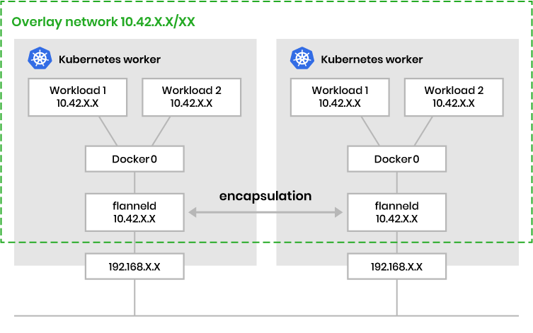

# Setup Kubernetes Cluster

In this section, it describes how to set up Kubernetes Cluster using physical host systems.
All host systems are expected to be Ubuntu 24.04 LTS with the packages installed via [Install Kubernetes Packages](./Install_Kubernetes_Packages.md).

## Reference

- [Kubernetes Official Documentation](https://kubernetes.io/docs/setup/)
- [Creating a cluster with kubeadm](https://kubernetes.io/docs/setup/production-environment/tools/kubeadm/create-cluster-kubeadm/)
- [Cilium Quick Installation](https://docs.cilium.io/en/stable/gettingstarted/k8s-install-default/)
- [Kubernetes CNI Explained](https://www.tigera.io/learn/guides/kubernetes-networking/kubernetes-cni/)

## Container Network Interface (CNI)

Before establish Kubernetes Cluster, there is important component to understand, which is Container Network Interface (CNI).
This is really important for ROS with Kubernetes use case since CNI is the network interface to ROS application container uses.
If inappropriate CNI plugin is bound to ROS application container, sometimes it fails to communicate via ROS network especially ROS 2 / DDS that uses **multicast** to endpoint discovery.



The above diagram shows that one of the CNI implementation called `flannel` to provide overlay network to application containers.
Using CNI plugin underneath, container runtime adds the interface to the container namespace via a call to the CNI plugin and allocates the connected subnetwork routes via calls to the IP Address Management (IPAM) plugin.

Here it does not explain details about CNI but CNI needs to be well considered based on your use case or application requirements since CNI is the network interface backend for application containers.

In this tutorial, [Cilium](https://cilium.io/) is the primary CNI plugin, since it supports multicast (beta) that is required for ROS 2 / DDS discovery between the cluster nodes.
[WeaveNet](https://github.com/weaveworks/weave), which used to be the recommended CNI in this tutorial for multicast support, has reached end of life and is no longer maintained, so it is removed from this tutorial.

## Setup Kubernetes API Server

1st we do need to set up Kubernetes API server (control-plane) to accept the worker nodes as cluster components.

```bash
### Be super user access
> sudo su -

### Make sure that swap is disabled
> swapoff -a

### Make sure containerd uses systemd cgroup driver, which is the default cgroup driver for kubelet
> grep SystemdCgroup /etc/containerd/config.toml
      SystemdCgroup = true

### Make sure kubeadm is installed to start the cluster
> kubeadm version
kubeadm version: &version.Info{Major:"1", Minor:"37", GitVersion:"v1.37.0", ...}

### (Optional) pull the control-plane images beforehand
> kubeadm config images pull

### Initialize control-plane node, it might take a few minutes to complete
### --pod-network-cidr is required for Flannel (10.244.0.0/16 is Flannel default), Cilium does not require it
> kubeadm init --pod-network-cidr=10.244.0.0/16 --cri-socket unix:///run/containerd/containerd.sock
[init] Using Kubernetes version: v1.37.0
[preflight] Running pre-flight checks
[preflight] Pulling images required for setting up a Kubernetes cluster
[preflight] This might take a minute or two, depending on the speed of your internet connection
[preflight] You can also perform this action beforehand using 'kubeadm config images pull'
...<snip>
Your Kubernetes control-plane has initialized successfully!

To start using your cluster, you need to run the following as a regular user:

  mkdir -p $HOME/.kube
  sudo cp -i /etc/kubernetes/admin.conf $HOME/.kube/config
  sudo chown $(id -u):$(id -g) $HOME/.kube/config

Alternatively, if you are the root user, you can run:

  export KUBECONFIG=/etc/kubernetes/admin.conf

You should now deploy a pod network to the cluster.
Run "kubectl apply -f [podnetwork].yaml" with one of the options listed at:
  https://kubernetes.io/docs/concepts/cluster-administration/addons/

Then you can join any number of worker nodes by running the following on each as root:

kubeadm join <YOUR_IP_ADDRESS>:6443 --token <YOUR_TOKEN> --discovery-token-ca-cert-hash <YOUR_HASH>
```

***make sure you save the last line that shows how to join the cluster from worker nodes with tokens and CA hash.***

If you lost the join command, it can be re-generated on the control-plane node as following.

```bash
> kubeadm token create --print-join-command
```

## Access API-server

Make sure that we can access Kubernetes API server w/o any problems.

```bash
### save the configuration
> mkdir -p $HOME/.kube
> cp -i /etc/kubernetes/admin.conf $HOME/.kube/config
> chown $(id -u):$(id -g) $HOME/.kube/config

### check node status, NotReady is expected until CNI plugin is deployed
> kubectl get nodes -o wide
NAME           STATUS     ROLES           AGE   VERSION   INTERNAL-IP     EXTERNAL-IP   OS-IMAGE           KERNEL-VERSION     CONTAINER-RUNTIME
tomoyafujita   NotReady   control-plane   1m    v1.37.0   192.168.1.248   <none>        Ubuntu 24.04 LTS   6.8.0-xx-generic   containerd://2.x.x

### check pods status, coredns stays Pending until CNI plugin is deployed
> kubectl get pods -A
NAMESPACE     NAME                                   READY   STATUS    RESTARTS   AGE
kube-system   coredns-xxxxxxxxxx-xxxxx               0/1     Pending   0          4m3s
kube-system   coredns-xxxxxxxxxx-xxxxx               0/1     Pending   0          4m3s
kube-system   etcd-tomoyafujita                      1/1     Running   0          4m16s
kube-system   kube-apiserver-tomoyafujita            1/1     Running   0          4m16s
kube-system   kube-controller-manager-tomoyafujita   1/1     Running   0          4m17s
kube-system   kube-proxy-xxxxx                       1/1     Running   0          4m3s
kube-system   kube-scheduler-tomoyafujita            1/1     Running   0          4m16s
```

## Worker Node Join

### Join the cluster

We need to do this procedure for all worker nodes to join the cluster system.

```bash
> sudo su -
> swapoff -a

> grep SystemdCgroup /etc/containerd/config.toml
      SystemdCgroup = true

> kubeadm version
kubeadm version: &version.Info{Major:"1", Minor:"37", GitVersion:"v1.37.0", ...}

> kubeadm join <YOUR_IP_ADDRESS>:6443 --token <YOUR_TOKEN> --discovery-token-ca-cert-hash <YOUR_HASH> --cri-socket unix:///run/containerd/containerd.sock
[preflight] Running pre-flight checks
[preflight] Reading configuration from the "kubeadm-config" ConfigMap in namespace "kube-system"...
[preflight] Use 'kubeadm init phase upload-config --config your-config.yaml' to re-upload it.
[kubelet-start] Writing kubelet configuration to file "/var/lib/kubelet/config.yaml"
[kubelet-start] Writing kubelet environment file with flags to file "/var/lib/kubelet/kubeadm-flags.env"
[kubelet-start] Starting the kubelet
[kubelet-check] Waiting for a healthy kubelet at http://127.0.0.1:10248/healthz. This can take up to 4m0s
[kubelet-check] The kubelet is healthy after 1.00xxxxxs
[kubelet-start] Waiting for the kubelet to perform the TLS Bootstrap

This node has joined the cluster:
* Certificate signing request was sent to apiserver and a response was received.
* The Kubelet was informed of the new secure connection details.

Run 'kubectl get nodes' on the control-plane to see this node join the cluster.
```

Check the node availability on control-plane node.

```bash
### check node status
> kubectl get nodes -o wide
```

## Deploy CNI plugin

To get cluster nodes ready, we need to deploy CNI plugin as pods.
Here it describes install / uninstall CNI plugins via `cilium` CLI or `kubectl`, CNI plugins are managed under kubernetes pods as well.

### [Cilium](https://cilium.io/)

You can refer to [Quick Installation](https://docs.cilium.io/en/stable/gettingstarted/k8s-install-default/) for Kubernetes if needed.

#### Install Cilium CLI

This operation is only required once for control-plane node (or wherever `kubectl` can access the cluster).
The Cilium CLI can be used to install Cilium, inspect the state of a Cilium installation, and enable/disable various features.

```bash
> sudo su -
> cd <repo>/scripts
> ./install_cilium_cli.sh
...<snip>
Cilium CLI is installed on /usr/local/bin/cilium, for uninstallation you can just delete the executable.
cilium-cli: v0.20.1 compiled with go1.27.1 on linux/amd64
```

#### Install Cilium CNI to the Kubernetes Cluster

```bash
> cilium version
cilium-cli: v0.20.1 compiled with go1.27.1 on linux/amd64
cilium image (default): v1.20.1
cilium image (stable): v1.20.2
cilium image (running): unknown. Unable to obtain cilium version. Reason: release: not found

### Install Cilium with the default configuration (tunnel/vxlan routing mode)
> cilium install --version 1.20.2
🔮 Auto-detected Kubernetes kind: kubernetes
ℹ️  Using Cilium version 1.20.2
🔮 Auto-detected cluster name: kubernetes
🔮 Auto-detected kube-proxy has been installed

### Wait until Cilium is ready
> cilium status --wait
    /¯¯\
 /¯¯\__/¯¯\    Cilium:             OK
 \__/¯¯\__/    Operator:           OK
 /¯¯\__/¯¯\    Envoy DaemonSet:    OK
 \__/¯¯\__/    Hubble Relay:       disabled
    \__/       ClusterMesh:        disabled
...<snip>

### Now the nodes become Ready
> kubectl get nodes
```

#### Enable Security Encryption

Cilium provides security encryption feature either IPsec or WireGuard statically during initialization.
Packets are not encrypted when they are destined to the same node from which they were sent. This behavior is intended.
Encryption would provide no benefits in that case, given that the raw traffic can be observed on the node anyway.
IPsec encryption requires key, the following procedure uses Kubernetes Secret to bind the key for cilium encryption.
see [IPsec Transparent Encryption](https://docs.cilium.io/en/stable/security/network/encryption-ipsec/) for more details.

> [!NOTE]
> Cilium multicast (used by ROS 2 / DDS discovery) does not work together with IPsec encryption between Cilium-managed pods.

```bash
### If cilium is already deployed, uninstall from cluster system
> cilium uninstall

### Create Kubernetes Secret that is used for encryption
### "+" after key-id is strongly recommended to enable per-tunnel keys (global keys are deprecated since v1.16)
> PSK=$(dd if=/dev/urandom count=20 bs=1 2> /dev/null | xxd -p -c 64)

> echo $PSK
47b57a0241e4c5df0a196ccfbcc7ee1aff204100

> kubectl create -n kube-system secret generic cilium-ipsec-keys --from-literal=keys="3+ rfc4106(gcm(aes)) $PSK 128"
secret/cilium-ipsec-keys created

> kubectl -n kube-system get secrets cilium-ipsec-keys
NAME                TYPE     DATA   AGE
cilium-ipsec-keys   Opaque   1      10s

> kubectl get secrets cilium-ipsec-keys -o jsonpath='{.data.keys}' -n kube-system | base64 --decode
3+ rfc4106(gcm(aes)) 47b57a0241e4c5df0a196ccfbcc7ee1aff204100 128

### Start deployment with enabling encryption
> cilium install --version 1.20.2 --set encryption.enabled=true --set encryption.type=ipsec

### Check IPsec is enabled
> cilium config view | grep ipsec
enable-ipsec                               true
ipsec-key-file                             /etc/ipsec/keys

> kubectl -n kube-system exec -ti ds/cilium -- cilium-dbg encrypt status
Encryption: IPsec
Decryption interface(s): eth0
Keys in use: 2
...<snip>
```

#### Enable [Hubble Observability](https://github.com/cilium/hubble/)

Cilium also provides the observability component for gaining deep insights into the network and security behavior of your applications.
This also works with ROS and ROS 2 application containers.
Hubble collects network flow data using eBPF and processes it to generate valuable insights, this data can be visualized and analyzed through the Hubble UI or using the Hubble CLI.

see [Service Map & Hubble UI](https://docs.cilium.io/en/stable/observability/hubble/hubble-ui/) for more details.

```bash
### Enable Hubble Relay and Hubble UI
> cilium hubble enable --ui

> cilium status
...<snip>
 /¯¯\__/¯¯\    Hubble Relay:       OK
...<snip>

### Port forward Hubble UI to http://localhost:12000
> cilium hubble ui
ℹ️  Opening "http://localhost:12000" in your browser...
```


#### Enable Multicast

> [!NOTE]
> Cilium multicast is a **beta** feature, see [Multicast Support](https://docs.cilium.io/en/stable/network/multicast/) for the latest status and requirements.

The current mainstream container network plug-ins (such as Calico and Flannel) do not natively support multicast.
Cilium is one of the most advanced container network plug-in supports multicast based on eBPF, which focuses on solving the problem of efficient multicast transmission in the container network.
This allows ROS 2 / DDS (e.g. Fast DDS and Cyclone DDS) to discover the participants on the different cluster nodes using the well-known multicast group address without any extra configuration in the application containers.

Requirements:

- Cilium runs in tunnel (`vxlan`) routing mode, which is the default of `cilium install`.
- Linux kernel 5.10 or later on amd64, 6.0 or later on arm64 (Ubuntu 24.04 kernel 6.8 satisfies both).
- IPsec encryption is not supported together with multicast.

In default Cilium multicast feature is disabled, so we need to walk through the following configuration.

- Enable multicast feature

  After Cilium is deployed in the cluster, we can enable the multicast feature.
  This will restart the cilium-agent pods in the cluster.

  ```bash
  ### Check vxlan mode is enabled
  > kubectl get configmap cilium-config -n kube-system -o yaml | grep -E 'routing-mode|tunnel-protocol'
    routing-mode: tunnel
    tunnel-protocol: vxlan

  ### Enable multicast feature
  > cilium config set multicast-enabled true
  ✨ Patching ConfigMap cilium-config with multicast-enabled=true...
  ♻️  Restarted Cilium pods
  ```

- Configure Multicast Group and Subscribers using Cilium CLI (Recommended)

  To use multicast with Cilium, we need to configure multicast group and subscriber IP addresses based on the application requirement.
  ROS 2 (DDS) well-known multicast group IP address is `239.255.0.1`.

  If it's a cluster-wide operation, there's no need to perform operations on each cilium pod individually, `cilium multicast` command configures the group and subscribers on all nodes at once.

  ```bash
  # make all nodes join the specified multicast group
  > cilium multicast add --group-ip 239.255.0.1
  Added 2 nodes (kind-control-plane, kind-worker2) to multicast group 239.255.0.1 in kind-worker
  Added 2 nodes (kind-worker, kind-worker2) to multicast group 239.255.0.1 in kind-control-plane
  Added 2 nodes (kind-control-plane, kind-worker) to multicast group 239.255.0.1 in kind-worker2
  #cilium multicast delete --group-ip 239.255.0.1

  # confirm the multicast groups and subscribers
  > cilium multicast list group
  Node                 Group
  kind-worker          239.255.0.1
  kind-worker2         239.255.0.1
  kind-control-plane   239.255.0.1

  > cilium multicast list subscriber --all
  Node                 Group         Subscriber    Type
  kind-worker          239.255.0.1   10.244.2.43   Remote Node
                                     10.244.0.23   Remote Node
  kind-worker2         239.255.0.1   10.244.0.23   Remote Node
                                     10.244.1.25   Remote Node
  kind-control-plane   239.255.0.1   10.244.1.25   Remote Node
                                     10.244.2.43   Remote Node
  ```

- Multicast Group Address, UDP Port and `ROS_DOMAIN_ID`

  The DDS well-known multicast group address `239.255.0.1` is **independent from the DDS domain ID** (`ROS_DOMAIN_ID`), that is said one multicast group `239.255.0.1` is enough for all ROS 2 domains.
  [RTPS specification](https://www.omg.org/spec/DDSI-RTPS/) encodes the domain ID into the **UDP port number** instead of the multicast address, the default port mapping is the following.

  | Traffic | Default Port | Note |
  | --- | --- | --- |
  | Discovery (SPDP) multicast | `7400 + 250 * ROS_DOMAIN_ID` | `PB + DG * domainId + d0` (`PB=7400`, `DG=250`, `d0=0`) |
  | User data multicast | `7401 + 250 * ROS_DOMAIN_ID` | `PB + DG * domainId + d2` (`d2=1`), only used if subscriptions request multicast |
  | Discovery (SPDP) unicast | `7410 + 250 * ROS_DOMAIN_ID + 2 * participantId` | `d1=10`, `PG=2` |
  | User data unicast | `7411 + 250 * ROS_DOMAIN_ID + 2 * participantId` | `d3=11`, `PG=2` |

  e.g) `ROS_DOMAIN_ID=0` uses `239.255.0.1:7400`, `ROS_DOMAIN_ID=7` uses `239.255.0.1:9150` and `ROS_DOMAIN_ID=42` uses `239.255.0.1:17900` for the discovery.
  Since UDP port number is 16 bits, the default port mapping only works with `ROS_DOMAIN_ID` from `0` to `232`, see [The ROS_DOMAIN_ID](https://docs.ros.org/en/rolling/Concepts/Intermediate/About-Domain-ID.html) for the details.

  Cilium multicast forwards the packets based on the multicast group address regardless of the UDP port, so that the following verification shows that ROS 2 talker and listener on the different cluster nodes can discover each other with `ROS_DOMAIN_ID=42` (Fast DDS) and `ROS_DOMAIN_ID=7` (Cyclone DDS) with the group `239.255.0.1` configured above.
  The multicast packets can be observed by [Hubble](#enable-hubble-observability) CLI in the `cilium-agent` container on the node, `Multicast handled` verdict is reported as `DROPPED` since the packet is consumed and replicated to the subscribers by the Cilium multicast datapath (eBPF).

  ```bash
  ### talker (kind-worker) and listener (kind-worker2) with ROS_DOMAIN_ID=42
  > kubectl logs listener-d42 --tail=2
  [INFO] [1792430969.010081692] [listener]: I heard: [Hello World: 13]
  [INFO] [1792430970.010012735] [listener]: I heard: [Hello World: 14]

  ### observe the multicast packets with hubble in the cilium-agent container on kind-worker
  > CILIUM_POD=$(kubectl -n kube-system get pods -l k8s-app=cilium --field-selector spec.nodeName=kind-worker -o name)
  > kubectl -n kube-system exec $CILIUM_POD -c cilium-agent -- hubble observe --to-ip 239.255.0.1 --last 20
  Oct 19 17:29:58.466: default/listener-d42:37373 (ID:8663) <> 239.255.0.1:17900 (world) Multicast handled DROPPED (UDP)
  Oct 19 17:29:58.504: default/talker-d42:39513 (ID:40187) <> 239.255.0.1:17900 (world) Multicast handled DROPPED (UDP)
  Oct 19 17:30:03.965: default/listener-cyclone-d7:42686 (ID:8663) <> 239.255.0.1:9150 (world) Multicast handled DROPPED (UDP)
  Oct 19 17:30:04.109: default/talker-cyclone-d7:46227 (ID:8663) <> 239.255.0.1:9150 (world) Multicast handled DROPPED (UDP)
  ```

  Multicast group address needs to be added to Cilium if the application does not use the default `239.255.0.1`, for example,

  - DDS participant uses the user-defined multicast locator via XML profile ([Fast DDS](https://fast-dds.docs.eprosima.com/en/latest/fastdds/xml_configuration/domainparticipant.html#builtin-parameters) `metatrafficMulticastLocatorList`, [Cyclone DDS](https://cyclonedds.io/docs/cyclonedds/latest/config/config_file_reference.html) `General/Interfaces` and `Discovery/SPDPMulticastAddress`).
  - [rmw_zenoh](https://github.com/ros2/rmw_zenoh) uses `224.0.0.224:7446` for the scouting (discovery) in default, which is `224.0.0.0/24` link-local scope that is not forwarded to the other nodes.
  - [Gazebo Transport](https://gazebosim.org/api/transport/14/envvars.html) uses `239.255.0.7:10317` for the discovery in default.

  ```bash
  ### Add the multicast group for Gazebo Transport discovery
  > cilium multicast add --group-ip 239.255.0.7
  > cilium multicast list group
  ```

- Configure Multicast Group and Subscribers (Manually)

  **For each cilium pod**, we can also configure multicast groups and subscribers manually.
  The following commands need to be issued in `cilium` pods, there should be `cilium-dbg` command to access `cilium-agent`.

  ```bash
  > kubectl -n kube-system exec -ti <cilium-pod-on-the-node> -- bash
  > cilium-dbg bpf multicast group add 239.255.0.1
  > cilium-dbg bpf multicast group list
  Group Address
  239.255.0.1
  #cilium-dbg bpf multicast group delete 239.255.0.1
  ```

  Then we need to configure group subscriber IP addresses to that group from `CILIUMINTERNALIP` below.
  Subscriber IP addresses are the CiliumNode IP addresses of the **other** nodes, not the node's own IP address.

  ```bash
  > kubectl get ciliumnodes.cilium.io
  NAME                 CILIUMINTERNALIP   INTERNALIP   AGE
  kind-control-plane   10.244.0.23        172.18.0.3   36s
  kind-worker          10.244.1.25        172.18.0.2   39s
  kind-worker2         10.244.2.43        172.18.0.4   36s
  ```

  ```bash
  # On kind-control-plane
  cilium-dbg bpf multicast subscriber add 239.255.0.1 10.244.1.25
  cilium-dbg bpf multicast subscriber add 239.255.0.1 10.244.2.43
  #cilium-dbg bpf multicast subscriber delete 239.255.0.1 10.244.1.25
  cilium-dbg bpf multicast subscriber list all
  Group           Subscriber      Type
  239.255.0.1     10.244.1.25     Remote Node
                  10.244.2.43     Remote Node

  # On kind-worker
  cilium-dbg bpf multicast subscriber add 239.255.0.1 10.244.0.23
  cilium-dbg bpf multicast subscriber add 239.255.0.1 10.244.2.43
  cilium-dbg bpf multicast subscriber list all

  # On kind-worker2
  cilium-dbg bpf multicast subscriber add 239.255.0.1 10.244.0.23
  cilium-dbg bpf multicast subscriber add 239.255.0.1 10.244.1.25
  cilium-dbg bpf multicast subscriber list all
  ```

- Related Issues and Pull Requests
  - Issues
    - https://github.com/cilium/cilium/issues/13239, https://github.com/cilium/cilium/issues/28750
    - https://github.com/cilium/cilium/issues/29471 (Multicast IPsec Support, tracking issue)
  - Design CFP
    - https://github.com/cilium/design-cfps/pull/20
  - Pull Requests
    - https://github.com/cilium/cilium/pull/29469
    - https://github.com/cilium/cilium/pull/31355

#### Uninstall Cilium

```bash
> cilium uninstall
```

### [Flannel](https://github.com/flannel-io/flannel)

Flannel is a simple layer 3 overlay network that does not support multicast, so it can be used for ROS 1 or ROS 2 with unicast discovery (e.g. Fast DDS Discovery Server).
`kubeadm init` requires `--pod-network-cidr=10.244.0.0/16` for the default Flannel configuration.

```bash
### Install
> kubectl apply -f https://github.com/flannel-io/flannel/releases/latest/download/kube-flannel.yml
namespace/kube-flannel created
serviceaccount/flannel created
clusterrole.rbac.authorization.k8s.io/flannel created
clusterrolebinding.rbac.authorization.k8s.io/flannel created
configmap/kube-flannel-cfg created
daemonset.apps/kube-flannel-ds created

### Uninstall
> kubectl delete -f https://github.com/flannel-io/flannel/releases/latest/download/kube-flannel.yml
```

## Headlamp Dashboard

> [!NOTE]
> [Kubernetes Dashboard](https://github.com/kubernetes-retired/dashboard) has been deprecated and archived, so it is no longer maintained.
> The Kubernetes project recommends [Headlamp](https://headlamp.dev/) as the successor, which is now a Kubernetes SIG UI project.
> See [From Kubernetes Dashboard to Headlamp: Understanding the Transition](https://kubernetes.io/blog/2026/06/01/dashboard-to-headlamp/) for details.

Headlamp is an extensible Kubernetes web UI to monitor the cluster information and manage the workloads via GUI.
There are many monitoring workloads from other vendors, but Headlamp does good enough to see the entire cluster activity, and it can be extended with plugins if necessary.

See details for [Headlamp In-cluster Installation](https://headlamp.dev/docs/latest/installation/in-cluster/).

### Create ServiceAccount

Headlamp requires a token to log in.
Here we create `headlamp-admin` ServiceAccount bound to `cluster-admin` ClusterRole, the name and namespace must match the `headlamp-admin` Secret that is created by the Headlamp manifest below.

> [!IMPORTANT]
> The ServiceAccount must be created **before** the Headlamp manifest.
> The manifest creates `kubernetes.io/service-account-token` Secret for `headlamp-admin` ServiceAccount, and Kubernetes token controller deletes that Secret right away if the ServiceAccount does not exist yet.

**see deployment description [Headlamp Admin ServiceAccount](./../yaml/headlamp-admin.yaml)**

```bash
### Create ServiceAccount and ClusterRoleBinding
> kubectl apply -f ./yaml/headlamp-admin.yaml
serviceaccount/headlamp-admin created
clusterrolebinding.rbac.authorization.k8s.io/headlamp-admin created
```

### Deploy Headlamp

The following deploys Headlamp into `kube-system` namespace.

```bash
### Start Headlamp
> kubectl apply -f https://raw.githubusercontent.com/kubernetes-sigs/headlamp/main/kubernetes-headlamp.yaml
service/headlamp created
deployment.apps/headlamp created
secret/headlamp-admin created

### Check Headlamp pod and service are running
> kubectl get pods -n kube-system -l k8s-app=headlamp
NAME                        READY   STATUS    RESTARTS   AGE
headlamp-65978d54db-9ljmh   1/1     Running   0          105s
> kubectl get service -n kube-system headlamp
NAME       TYPE        CLUSTER-IP      EXTERNAL-IP   PORT(S)   AGE
headlamp   ClusterIP   10.96.176.106   <none>        80/TCP    105s

### Make sure the Secret is bound to the ServiceAccount (it is deleted if the ServiceAccount is missing)
> kubectl -n kube-system get secret headlamp-admin
NAME             TYPE                                  DATA   AGE
headlamp-admin   kubernetes.io/service-account-token   3      105s
```

The manifest above uses `ghcr.io/headlamp-k8s/headlamp:latest` image.
If you need to pin the Headlamp version, use [Helm chart](https://headlamp.dev/docs/latest/installation/in-cluster/#using-helm) instead.

```bash
> helm repo add headlamp https://kubernetes-sigs.github.io/headlamp/
> helm install my-headlamp headlamp/headlamp --namespace kube-system
```

### Create ServiceAccount Token

```bash
### Generate token to bind ServiceAccount
> kubectl -n kube-system create token headlamp-admin --duration=8760h
...<snip>

### Copy the above token
```

The token generated above expires after the specified duration.
The `headlamp-admin` Secret created by the manifest holds a long-lived token for the same ServiceAccount, that can be used instead.

```bash
> kubectl -n kube-system get secret headlamp-admin -o jsonpath='{.data.token}' | base64 --decode
```

### Access Headlamp

By default, Headlamp service uses Cluster IP address, so we need to `port-forward` it to the localhost or node IP address.

```bash
### Port forward to localhost
> kubectl port-forward -n kube-system service/headlamp 8080:80
Forwarding from 127.0.0.1:8080 -> 4466

### Port forward to the node IP address, if accessing from other hosts
> kubectl port-forward -n kube-system service/headlamp 8080:80 --address YOUR_NODE_IP
```

Access http://localhost:8080/ (or `http://<YOUR_NODE_IP>:8080/`), and input the token which has been generated above procedure to log in.
Now you should be able to see the Kubernetes cluster overview on Headlamp.

### Uninstall Headlamp

```bash
> kubectl delete -f https://raw.githubusercontent.com/kubernetes-sigs/headlamp/main/kubernetes-headlamp.yaml
> kubectl delete -f ./yaml/headlamp-admin.yaml
```

## Break down the cluster

the following command needs to be issued on each node in the cluster system.

```bash
### Uninstall CNI plugin first if cilium is deployed (on control-plane)
cilium uninstall

### Reset the node
kubeadm reset -f --cri-socket unix:///run/containerd/containerd.sock
rm -rf $HOME/.kube/config

### CNI conflist will be re-created by CNI installation.
rm -rf /etc/cni/net.d

### Flush iptables rules created by kube-proxy and CNI (optional)
iptables -F && iptables -t nat -F && iptables -t mangle -F && iptables -X
```
