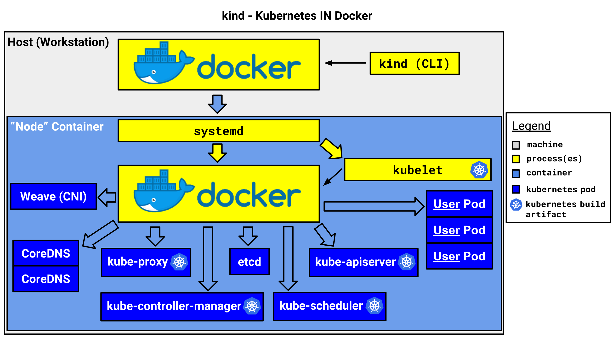

# Setup Virtualized Kubernetes Cluster

In this section, it describes how to set up virtual Kubernetes cluster using single physical host system.

## Reference

- [Kubernetes IN Docker official document](https://kind.sigs.k8s.io/)
- [kind Configuration](https://kind.sigs.k8s.io/docs/user/configuration/)
- [Set up Kind cluster(Japanese)](https://qiita.com/tomoyafujita/items/5a3c06705f62c5732bc5)

## Kubernetes IN Docker

`K`ubernetes `IN` `D`ocker called `kind` is command line tool to create virtualized kubernetes cluster on single physical host system.
It creates docker containers as cluster host system with using linux namespaces, and starts systemd, kubelet and kubernetes api-server in those containers.
In one word, kind uses docker containers in the host docker system, so that it just appears to be virtual host systems are running as containers.
Command operation using `kubectl` will be port forwarded to the virtualized cluster node to conceal the abstraction as user experience.



***Once kubernetes virtualized cluster is ready, everything else will be the same with physical cluster operation with using `kubectl` command.***

## Install

See [Install Kubernetes Packages](../docs/Install_Kubernetes_Packages.md)
If the installation has been completed, we can see the kind version as following.

```bash
# No root permission is required to use KIND, but the user must be in docker group
> docker version
> kind version
kind v0.33.0 go1.25.0 linux/amd64
```

kind `v0.33.0` uses `kindest/node:v1.37.0` as the default node image, that is said Kubernetes `v1.37.0` is deployed in the virtual cluster.
Other Kubernetes versions can be used via `--image` option with the pre-built node images listed in [kind releases](https://github.com/kubernetes-sigs/kind/releases), it is recommended to pin the image with `@sha256` digest.

## Single node cluster setup

- Start kind cluster

```bash
> kind create cluster
Creating cluster "kind" ...
 ✓ Ensuring node image (kindest/node:v1.37.0) 🖼
 ✓ Preparing nodes 📦
 ✓ Writing configuration 📜
 ✓ Starting control-plane 🕹️
 ✓ Installing CNI 🔌
 ✓ Installing StorageClass 💾
Set kubectl context to "kind-kind"
You can now use your cluster with:

kubectl cluster-info --context kind-kind

Have a nice day! 👋

> kubectl config get-contexts
CURRENT   NAME        CLUSTER     AUTHINFO    NAMESPACE
*         kind-kind   kind-kind   kind-kind

> kubectl cluster-info --context kind-kind
Kubernetes control plane is running at https://127.0.0.1:33691
CoreDNS is running at https://127.0.0.1:33691/api/v1/namespaces/kube-system/services/kube-dns:dns/proxy

To further debug and diagnose cluster problems, use 'kubectl cluster-info dump'.
```

that is all to setup the Kubernetes Cluster, as you can see below, cluster is ready.
during cluster creation, kind adds the cluster configuration to `${HOME}/.kube/config`, so that user can access the cluster system via `kubectl` command.
at the same time, it binds one of the host port to container runtime which runs Kubernetes api-server.

Single node cluster uses `kindnet` as the default CNI plugin, which is enough for the single node cluster but does not support multicast.

- Check cluster information

```bash
> kubectl get nodes -o wide
NAME                 STATUS   ROLES           AGE    VERSION   INTERNAL-IP   EXTERNAL-IP   OS-IMAGE                         KERNEL-VERSION     CONTAINER-RUNTIME
kind-control-plane   Ready    control-plane   5m1s   v1.37.0   172.18.0.2    <none>        Debian GNU/Linux 12 (bookworm)   6.8.0-xx-generic   containerd://2.x.x

> docker ps
CONTAINER ID   IMAGE                  COMMAND                  CREATED         STATUS         PORTS                       NAMES
74f62b76ac50   kindest/node:v1.37.0   "/usr/local/bin/entr…"   7 minutes ago   Up 7 minutes   127.0.0.1:33691->6443/tcp   kind-control-plane
```

- Delete kind cluster

```bash
> kind delete cluster
Deleting cluster "kind" ...
```

## Multiple node cluster setup

It is likely that we need multiple nodes in virtual cluster to check pods and services connectivity for verification.
To create multiple nodes cluster system with kind, yaml description is required to load to kind when it creates the virtual cluster.

we can also see [Kind Advanced Tutorial](https://kind.sigs.k8s.io/docs/user/quick-start/#advanced).

- Start kind cluster

using [KIND multiple node description](../yaml/kind-multiple-node.yaml), kind can creates the virtual cluster with 3 virtual nodes as following.
In this description, the default CNI (`kindnet`) is disabled (`disableDefaultCNI: true`) so that we can deploy Cilium as CNI plugin, which supports multicast for ROS 2.

```bash
> kind create cluster --config=./yaml/kind-multiple-node.yaml
Creating cluster "kind" ...
 ✓ Ensuring node image (kindest/node:v1.37.0) 🖼
 ✓ Preparing nodes 📦 📦 📦
 ✓ Writing configuration 📜
 ✓ Starting control-plane 🕹️
 ✓ Installing StorageClass 💾
 ✓ Joining worker nodes 🚜
Set kubectl context to "kind-kind"
You can now use your cluster with:

kubectl cluster-info --context kind-kind

Have a nice day! 👋

> kubectl cluster-info --context kind-kind
Kubernetes control plane is running at https://127.0.0.1:46403
CoreDNS is running at https://127.0.0.1:46403/api/v1/namespaces/kube-system/services/kube-dns:dns/proxy

To further debug and diagnose cluster problems, use 'kubectl cluster-info dump'.

### Nodes are NotReady until CNI plugin is deployed
> kubectl get nodes -o wide
NAME                 STATUS     ROLES           AGE   VERSION   INTERNAL-IP   EXTERNAL-IP   OS-IMAGE                         KERNEL-VERSION     CONTAINER-RUNTIME
kind-control-plane   NotReady   control-plane   76s   v1.37.0   172.18.0.3    <none>        Debian GNU/Linux 12 (bookworm)   6.8.0-xx-generic   containerd://2.x.x
kind-worker          NotReady   <none>          55s   v1.37.0   172.18.0.2    <none>        Debian GNU/Linux 12 (bookworm)   6.8.0-xx-generic   containerd://2.x.x
kind-worker2         NotReady   <none>          55s   v1.37.0   172.18.0.4    <none>        Debian GNU/Linux 12 (bookworm)   6.8.0-xx-generic   containerd://2.x.x
```

- Deploy Cilium CNI plugin

  see [Install Cilium CLI](./Setup_Kubernetes_Cluster.md#install-cilium-cli) to install `cilium` CLI in the host system.
  `cilium install` auto-detects kind cluster and configures Cilium accordingly.

```bash
> cilium install --version 1.20.2
🔮 Auto-detected Kubernetes kind: kind
ℹ️  Using Cilium version 1.20.2
🔮 Auto-detected cluster name: kind-kind
🔮 Auto-detected kube-proxy has been installed

> cilium status --wait
...<snip>

> kubectl get nodes -o wide
NAME                 STATUS   ROLES           AGE   VERSION   INTERNAL-IP   EXTERNAL-IP   OS-IMAGE                         KERNEL-VERSION     CONTAINER-RUNTIME
kind-control-plane   Ready    control-plane   3m    v1.37.0   172.18.0.3    <none>        Debian GNU/Linux 12 (bookworm)   6.8.0-xx-generic   containerd://2.x.x
kind-worker          Ready    <none>          3m    v1.37.0   172.18.0.2    <none>        Debian GNU/Linux 12 (bookworm)   6.8.0-xx-generic   containerd://2.x.x
kind-worker2         Ready    <none>          3m    v1.37.0   172.18.0.4    <none>        Debian GNU/Linux 12 (bookworm)   6.8.0-xx-generic   containerd://2.x.x
```

  To use ROS 2 / DDS multicast discovery between the virtual nodes, see [Enable Multicast](./Setup_Kubernetes_Cluster.md#enable-multicast).

```bash
> cilium config set multicast-enabled true
> cilium multicast add --group-ip 239.255.0.1
> cilium multicast list subscriber --all
```

- Load local container images (Optional)

  kind nodes pull the container images from the registry in default, locally built images can be loaded into the kind nodes directly.

```bash
> kind load docker-image tomoyafujita/ros:rolling
```

- Delete kind cluster

```bash
> kind delete cluster
Deleting cluster "kind" ...
```
