# ROS 2 with Kubernetes and KubeEdge

## Overview and Current Status (October 2026)

Tomoya Fujita
[github.com/fujitatomoya](https://github.com/fujitatomoya)

<!---
# Overview slide deck for https://github.com/fujitatomoya/ros_k8s
# Summarizes the current status of the repository as of October 2026.
--->

---

# Agenda

- Background, Motivation and Goal
- Why Kubernetes (and KubeEdge) for Robotics
- The `ros_k8s` Repository: What is Verified Today
- Networking: Cilium, Multicast, Hubble and Encryption
- ROS 2 Deployment Patterns
- KubeEdge: Cloud / Edge Coordination
- Roadmap / Open Topics
- References

---

# Background / Problems

- Broad use cases (factory, logistics, entertainment, rescue, car, drone...)
- ROS 2 is a distributed and connected system (DDS, multicast discovery)
- Collaborative and orchestrated applications across many devices
- AI / ML Ops and application lifecycle at the edge
- Hardware acceleration and platform dependencies
- Everything tends to be **statically configured and integrated**

<!---
# The problem statement has not changed since ROSCon 2023, the tooling has.
--->

---

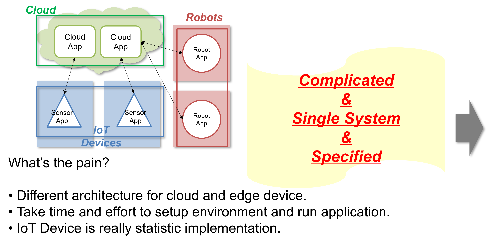

<!---
# Each robot / edge device is integrated by hand, network and devices are hard-wired to the application.
--->

---

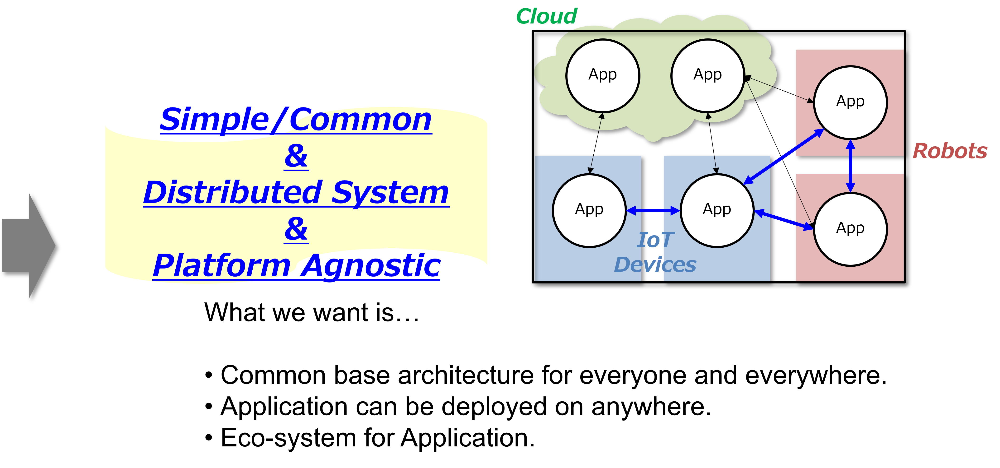

<!---
# Cloud and Edge Common Platform: the application is agnostic from the system, the system is agnostic from the application.
--->

---

# Goal / Requirements

- Flexible and configurable application deployment
- Application agnostic network, device and storage abstraction
- Application modularity / platform agnostic infrastructure
- Sustainability / efficiency on resource constrained devices
- System global observability / network policy / security
- **Everyone can try ROS 2 with Kubernetes and KubeEdge**
  - that is the motivation of [fujitatomoya/ros_k8s](https://github.com/fujitatomoya/ros_k8s)

---

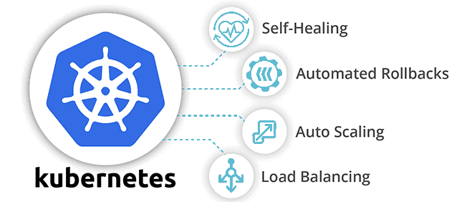

# Kubernetes

- Application deployment and orchestration
- Device capability and label control (`nodeSelector`)
- Auto-scaling and self-healing (`restartPolicy`)
- Rolling update / rollback, canary test
- Role Based Access Control
- Device Plugin / Container Device Interface (CDI)
- Container Network Interface (CNI)
- Observability / Network Policy

---

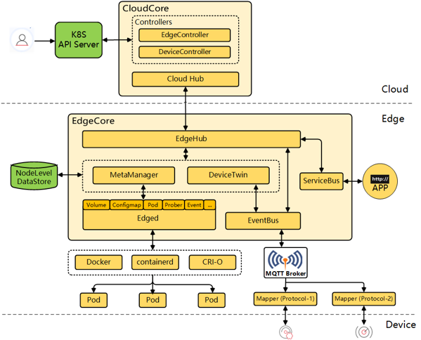

# KubeEdge

- Cloud-Edge coordination over the Internet (NAT friendly tunnel)
- Edge autonomy (works while offline)
- Kubernetes-native: edge nodes are just nodes
- Resource efficient (`edgecore` replaces `kubelet`)
- CNCF graduated project, SIG Robotics

---

# The `ros_k8s` Repository

- Tutorials to run ROS / ROS 2 on Kubernetes and KubeEdge, end to end
  - install packages, build multi-arch images (amd64 / aarch64)
  - physical cluster (`kubeadm`) or virtual cluster (`kind`)
  - CNI (Cilium), multicast, observability, encryption, Headlamp
  - ROS 2 deployment samples from basic to intermediate
  - KubeEdge cloudcore / edgecore and resource management
- Container images: `tomoyafujita/ros:{rolling,jazzy,noetic}`
- Everything is re-verified in 2026 on Ubuntu 24.04 LTS

---

# Verified Versions (October 2026)

| Component | Version |
| --- | --- |
| Ubuntu | 24.04 LTS (Noble), amd64 / aarch64 (Raspberry Pi 4/5) |
| Kubernetes | v1.37 |
| KubeEdge | v1.23.1 (verified with Kubernetes v1.30 - v1.32) |
| kind | v0.33.0 (`kindest/node:v1.37.0`) |
| Cilium | v1.20.x (cilium-cli v0.20.x) |
| containerd | 2.x (Docker apt repository) |
| ROS 2 | Jazzy (LTS, Ubuntu 24.04) / Rolling (Ubuntu 26.04 image) |
| ROS 1 | Noetic (EOL May 2025, kept for reference) |

---

# Cluster Options: Physical or Virtual

- **Physical host cluster** (`kubeadm init` / `kubeadm join`)
  - the practical environment for robots, sensors and accelerators
  - `containerd` with `SystemdCgroup = true`, swap disabled
- **Virtual cluster with kind** (Kubernetes IN Docker)
  - `kind create cluster --config=./yaml/kind-multiple-node.yaml`
  - 3 virtual nodes on one host, `disableDefaultCNI: true` to deploy Cilium
  - `kind load docker-image` to use locally built images
  - everything else is the same `kubectl` experience
- **Headlamp** (Kubernetes SIG UI) replaces the retired Kubernetes Dashboard

---

<!-- _class: dense -->

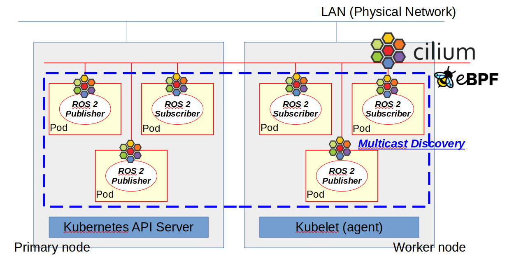

# CNI Matters for ROS 2 / DDS

- DDS discovers participants via **UDP multicast** (`239.255.0.1`)
- Flannel, Calico, kindnet: no multicast across nodes
- WeaveNet used to be the answer, now **end of life**
- **Cilium** is the primary CNI in this tutorial
  - eBPF based multicast (**beta**)
  - tunnel (`vxlan`) routing mode
  - kernel 5.10+ (amd64) / 6.0+ (arm64)

---

# Enable Cilium Multicast for DDS Discovery

```bash
> cilium install --version 1.20.2
> cilium status --wait

# enable multicast (restarts cilium-agent pods)
> cilium config set multicast-enabled true

# make all nodes join the ROS 2 / DDS well-known group at once
> cilium multicast add --group-ip 239.255.0.1
> cilium multicast list group
> cilium multicast list subscriber --all
```

- One command for the whole cluster, no per-node `cilium-dbg bpf multicast ...`
- Discovery across nodes just works, no change in the application container

---

<!-- _class: dense -->

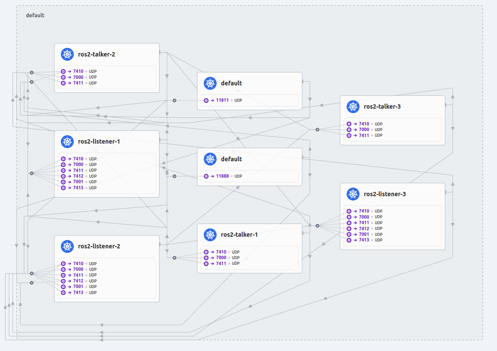

# Hubble Observability

- eBPF based network flow visibility for ROS 2 pods
- No sidecar, no change in the application

```bash
> cilium hubble enable --ui
> cilium hubble ui
# http://localhost:12000
```

- Service map shows who talks to whom (DDS discovery, topics)
- Hubble CLI for flow level debugging

---

# Transparent Encryption: IPsec / WireGuard

- Cilium encrypts node-to-node pod traffic with IPsec or WireGuard

```bash
> kubectl create -n kube-system secret generic cilium-ipsec-keys \
    --from-literal=keys="3+ rfc4106(gcm(aes)) $PSK 128"
> cilium install --version 1.20.2 \
    --set encryption.enabled=true --set encryption.type=ipsec
```

- Per-tunnel keys (`+`) recommended, global keys deprecated since v1.16
- **Multicast does not work together with IPsec encryption**
  - tracking issue: [cilium/cilium#29471](https://github.com/cilium/cilium/issues/29471)
  - choose: multicast discovery **or** IPsec, or go unicast (discovery server)

---

<!-- _class: dense -->

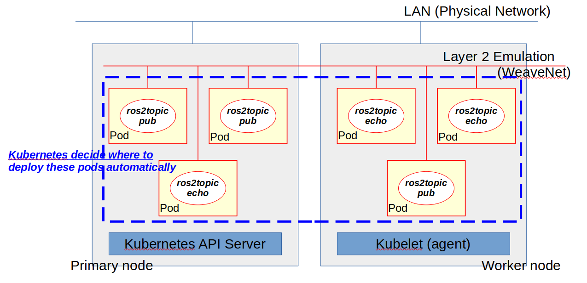

# Pattern 1: Simple Distributed System

- Talkers and listeners as `Deployment`, no `nodeSelector`
- Kubernetes decides where to run, restarts on failure
- Cilium multicast delivers DDS discovery to all nodes
- "I do not care where, but it must be running somewhere"

```bash
> kubectl apply -f ./yaml/ros2-sample.yaml
> kubectl logs deployment/ros2-listener-3
data: Hello, I am talker-3
```

---

<!-- _class: dense -->

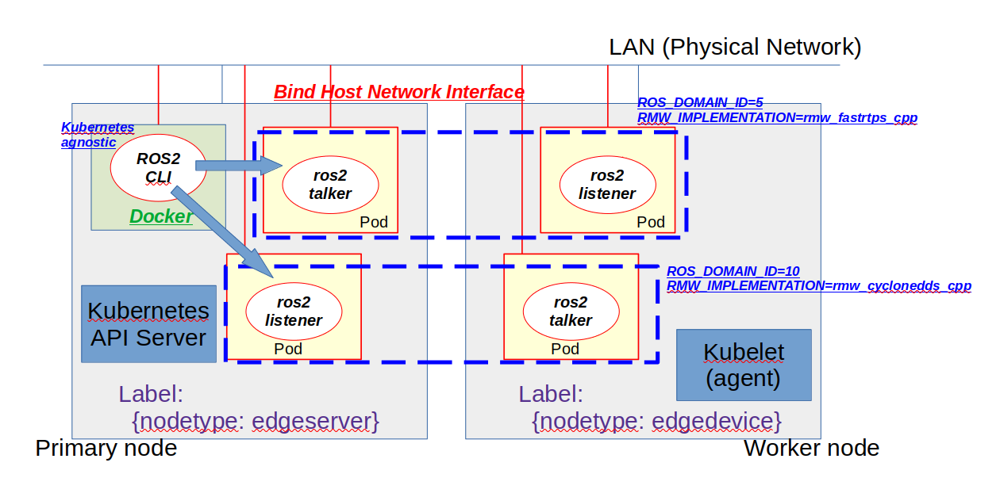

# Pattern 2: Localhost Only / Logical Partition

- **Localhost only**: `DaemonSet` per node
  - `ROS_AUTOMATIC_DISCOVERY_RANGE=LOCALHOST`
  - one virtual localhost per pod, multi-user on one node
  - `ROS_LOCALHOST_ONLY` is deprecated since Iron
- **Logical partition**: node labels + `ConfigMap`
  - `ROS_DOMAIN_ID` / `RMW_IMPLEMENTATION` injected as env
  - Fast DDS, Cyclone DDS, Connext configurations
  - configuration is separated from the container image

---

<!-- _class: dense -->


# Pattern 3: GUI Display Access

- Label the node that has a display: `nodetype=edgeserver`
- Mount `/tmp/.X11-unix`, set `DISPLAY`, `xhost +local:root`
- `turtlesim` and `rqt` run on the display node, `teleop_key` on `edgedevice`
- Ubuntu 24.04 Wayland session works via `Xwayland`

```bash
> kubectl apply -f ./yaml/ros2-turtlesim.yaml
> kubectl exec -it <teleop-pod> -- ros2 run turtlesim turtle_teleop_key
```

---

<!-- _class: dense -->


# Pattern 4: Zero Copy Data Sharing

- ROS 2 `LoanedMessage` + Fast DDS Data Sharing Delivery
- True zero copy between containers in the **same pod**
- Bind one `/dev/shm` tmpfs to all containers in the pod
- No daemon process required (Fast DDS)

```bash
> kubectl apply -f ./yaml/ros2-data-sharing.yaml
> kubectl exec <pod> -c ros2-listener-1 -- ls /dev/shm
fastdds_1db5a9b5dadec5a6
```

---

<!-- _class: dense -->


# Pattern 5: Fast DDS Discovery Server

- Centralized discovery, **no multicast required** (works with Flannel)
- Primary / secondary: `fastdds discovery -i <id> -p <port>`
- **Headless Service** (`clusterIP: None`) gives a stable DNS name

```yaml
- name: ROS_DISCOVERY_SERVER
  value: "primary-discovery-server:11811;secondary-discovery-server:11888"
```

- Resolved by cluster DNS at startup, no static IP in the application
- `ROS_SUPER_CLIENT=true` for `ros2cli` introspection

---

<!-- _class: dense -->


# Pattern 6: SROS2 Enclaves with ConfigMap

- Admin generates enclaves: `ros2 security create_keystore` / `create_enclave`
- `cp -L` and `kubectl create configmap --from-file` (no symlinks in ConfigMap)
- Env ConfigMap: `ROS_SECURITY_KEYSTORE` / `ROS_SECURITY_ENABLE` / `ROS_SECURITY_STRATEGY=Enforce`
- Kubernetes binds the right enclave wherever the pod starts
- ConfigMap is not encrypted: use **Secret** for `key.pem` in production

---

<!-- _class: dense -->

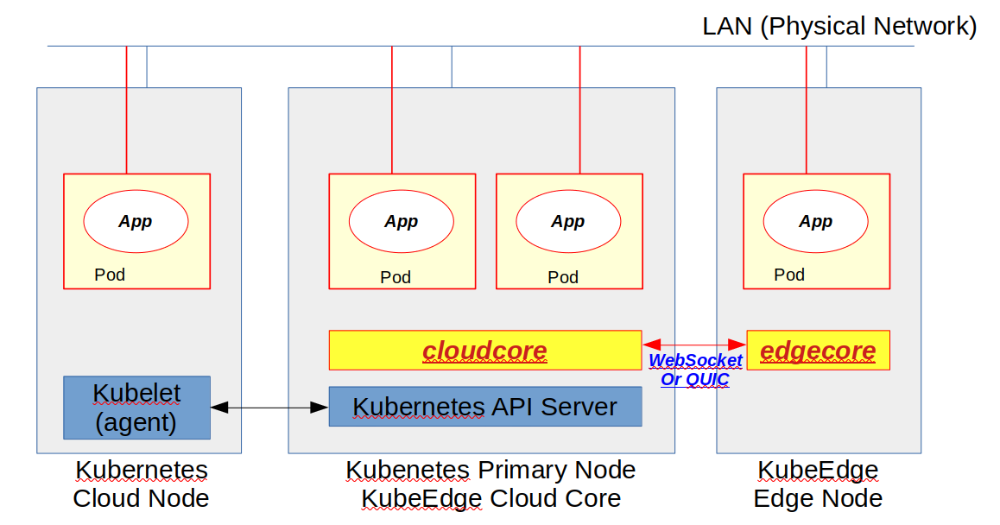

# KubeEdge: cloudcore / edgecore

- Cloud: Kubernetes API server + CNI, then `keadm init --advertise-address=<IP>`
  - ports `10000` / `10002` must be reachable from the edge
- Edge: `containerd` only, **no kubelet**, `keadm join`
  - `--kubeedge-version=v1.23.1 --cgroupdriver=systemd`
- Edge node shows up with role `agent,edge` in `kubectl get nodes`
- `edgecore` does not deploy CNI pods: ROS 2 pods on the edge use `hostNetwork: true`
- `kubectl logs/exec` on the edge needs `cloudStream` / `edgeStream`

---

# Cilium with KubeEdge

- [KubeEdge docs: Cilium](https://kubeedge.io/docs/advanced/cilium/) (KubeEdge v1.16+)
  - `cilium install --set encryption.type=wireguard`
  - `configure_cilium.sh cloudcore` / `configure_cilium.sh edgecore`
  - cilium-agent API calls go through `MetaManager` on the edge
  - edge pods get Cilium IPs and talk to cloud pods over WireGuard
- [Cilium + eBPF Day NA 2024: Applying Cilium at Edge with KubeEdge](https://static.sched.com/hosted_files/colocatedeventsna2024/15/Cilium%2BeBPF-Day-NA_Cilium-with-KubeEdge.v0.pdf)
  - Cilium + WireGuard on every cloud and edge node = one data plane
  - open: WireGuard topologies (hub-and-spoke, site-to-site), lighter footprint, scale to millions of devices
- Not yet in this tutorial: Cilium (multicast / WireGuard) on the KubeEdge edge node with ROS 2

---

# KubeEdge Hold and Release

- Problem: an uncontrolled rolling update can stop a moving robot
- [Hold and Release](https://kubeedge.io/docs/advanced/hold_and_release) (KubeEdge v1.22+): the **edge decides when** to upgrade
- Pod template annotation `edge.kubeedge.io/hold-upgrade: "true"`
  - `edged` caches the new pod, reports `HeldUpgrade` condition
  - held upgrade survives edge node restart (MetaManager)
- Release from the edge node (MetaServer required)

```bash
> keadm ctl unhold-upgrade node <node-name>
```

- Pods, Deployments, StatefulSets, DaemonSets are supported
- Natural fit for robots: upgrade when docked, not while driving

---

<!-- _class: dense -->

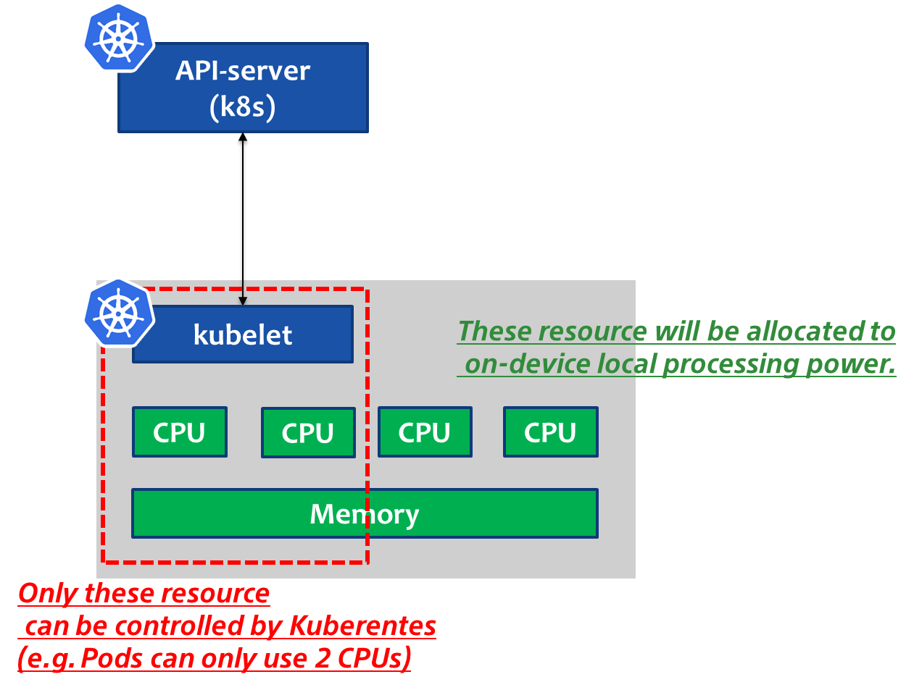

# Resource Reservation for Edge

- Robots need CPU / memory for the host system (drivers, real-time)
- `kubelet` Node Allocatable in `/var/lib/kubelet/config.yaml`

```yaml
reservedSystemCPUs: "2-3"
systemReserved:
  memory: 4Gi
evictionHard:
  memory.available: "5%"
```

- Raspberry Pi 4: allocatable 4 -> 2 CPUs, 8 -> 4 GiB
- Pod `requests` / `limits` on the application side

---

# What Has Changed Since 2023

- WeaveNet (EOL) -> **Cilium** with eBPF multicast, Hubble, encryption
- Kubernetes Dashboard (retired) -> **Headlamp**
- Ubuntu 22.04 -> **24.04**, Kubernetes v1.25 -> **v1.37**, containerd 1.6 -> **2.x**
- kind v0.16 -> **v0.33**, KubeEdge v1.14 -> **v1.23.1** (Kubernetes pinned to v1.32 for KubeEdge)
- New samples: zero copy, discovery server, SROS2 enclaves (closed #31, #18)
- ROS 2 Rolling only -> **Jazzy LTS + Rolling**, ROS 1 Noetic reached EOL
- `cilium multicast` CLI replaces per-node `cilium-dbg` operation

---

# Roadmap / Open Topics

- [#66](https://github.com/fujitatomoya/ros_k8s/issues/66) OpenKruise advanced CRDs for edge (in-place update)
- [#39](https://github.com/fujitatomoya/ros_k8s/issues/39) Gazebo simulation tutorial
- [#17](https://github.com/fujitatomoya/ros_k8s/issues/17) NVIDIA device plugin
- [#3](https://github.com/fujitatomoya/ros_k8s/issues/3) KubeEdge with far-edge micro-ROS
- [#42](https://github.com/fujitatomoya/ros_k8s/issues/42) re-verify samples with Cilium multicast
- [#62](https://github.com/fujitatomoya/ros_k8s/issues/62) DDS multicast address vs `ROS_DOMAIN_ID`
- [#54](https://github.com/fujitatomoya/ros_k8s/issues/54) SROS2 `ros2cli` output
- [#49](https://github.com/fujitatomoya/ros_k8s/issues/49) `crictl` debugging on nodes

---

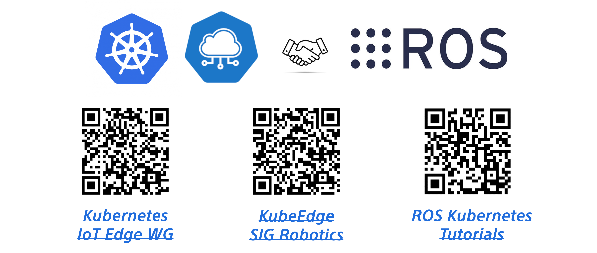

# Still Missing

- Cilium (multicast + WireGuard) on KubeEdge edge nodes, verified with ROS 2
- Multicast together with encryption
- Hardware acceleration: GPU / device plugin / CDI samples
- Far-edge devices: micro-ROS, WasmEdge
- Edge-aware rollout: hold and release, in-place update
- **Feedback and use cases are welcome**

---

# References

- Repository: [github.com/fujitatomoya/ros_k8s](https://github.com/fujitatomoya/ros_k8s)
- ROSCon 2023: [Slides](https://roscon.ros.org/2023/talks/ROS_with_KubernetesKubeEdge.pdf) / [Talk](https://vimeo.com/879001688/33b2495a49)
- ROS By the Bay 2023: [Slide Deck](https://raw.githack.com/fujitatomoya/ros_k8s/main/presentation/ROS-By-the-Bay_20231214.html)
- Cilium + eBPF Day NA 2024: [Applying Cilium at Edge with KubeEdge](https://static.sched.com/hosted_files/colocatedeventsna2024/15/Cilium%2BeBPF-Day-NA_Cilium-with-KubeEdge.v0.pdf)
- KubeEdge: [Documentation](https://kubeedge.io/docs/welcome/getting-started) / [Cilium](https://kubeedge.io/docs/advanced/cilium/) / [Hold and Release](https://kubeedge.io/docs/advanced/hold_and_release) / [KubeEdge meets Cilium](https://kubeedge.io/blog/enable-cilium/)
- Cilium: [Documentation](https://docs.cilium.io/en/stable/) / [Multicast](https://docs.cilium.io/en/stable/network/multicast/) / [IPsec](https://docs.cilium.io/en/stable/security/network/encryption-ipsec/)
- [Kubernetes](https://kubernetes.io/docs/home/) / [kind](https://kind.sigs.k8s.io/) / [Headlamp](https://headlamp.dev/)
- [ROS 2 Jazzy](https://docs.ros.org/en/jazzy/) / [ROS 2 Rolling](https://docs.ros.org/en/rolling/)

---

# Questions?

[github.com/fujitatomoya/ros_k8s](https://github.com/fujitatomoya/ros_k8s)

<!---
# Thank you!
--->
